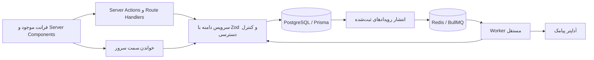

# گزارش فاز اول بک‌اند CRM هم‌مدار

**تاریخ بررسی ۱۴۰۵/۰۸/۲۵ · دامنهٔ بررسی تحلیل و طراحی پیشنهادی**

این گزارش بر پایهٔ کد اجراشدهٔ فرانت، مدل‌های TypeScript و ERD موجود است. موارد پیشنهادی این سند برای تصمیم‌گیری پیش از فاز دوم‌اند. [DESIGN.md](./DESIGN.md) · [ERD.md](./ERD.md)

## ۱. وضعیت فعلی پروژه

پروژه App Router دارد و ۱۵ مسیر اصلی شامل ورود، تأیید OTP، ۱۲ بخش CRM و طراح گردش‌کار را تعریف می‌کند. فرم‌ها از React Hook Form و Zod، جدول‌ها از TanStack Table و بوم از React Flow استفاده می‌کنند. صفحات فعلی، پوسته، اجزای shadcn/ui، RTL، تم، اعلان و تقویم شمسی، نقطهٔ شروع اتصال بک‌اند هستند. [وابستگی‌ها](./package.json) · [پوسته](./frontend/components/shell.tsx) · [فرم مشترک](./frontend/components/record-form.tsx)

| مورد | نتیجهٔ مشاهده |
| --- | --- |
| ابزار و نسخه‌های نصب‌شده | Node.js `24.20.0`، npm `11.19.0`، Next.js `16.4.6`، React `19.3.1`، TypeScript `5.9.3`، Zod `4.6.7`، React Hook Form `7.92.0`، Tailwind CSS `4.3.5`، TanStack Table `8.21.3` و React Flow `12.12.1`. قالب `package.json` بازهٔ نسخه دارد و نسخهٔ واقعی از درخت نصب خوانده شد. |
| استقرار فعلی | `output: "export"` خروجی ایستا را در `out` می‌سازد. Route Handler یا Server Action پروژه، Prisma Schema، Migration، اتصال Redis، Worker و تست خودکار اختصاصی دیده نشد. |
| اتصال PostgreSQL | باینری PostgreSQL و کلاینت `17.11` موجودند و پوشهٔ داده نشانگر خوشهٔ نسخهٔ ۱۷ دارد. سرویس ویندوز `postgresql-x64-17` فعال است و `pg_isready` به `127.0.0.1:5432` پاسخ گرفت. تلاش غیرتعاملی برای خواندن کاتالوگ به درخواست رمز رسید. وجود یا عدم وجود دیتابیس و جداول CRM نامشخص است. |
| تنظیمات پروژه و Redis | فایل `.env` یا `.env.example` در پروژه وجود ندارد. `DATABASE_URL`، `DIRECT_URL`، `TEST_DATABASE_URL` و `REDIS_URL` در سطح فرایند، کاربر یا ماشین تنظیم نشده‌اند. سرویس Redis و Docker در بررسی امکانات محلی تأیید نشدند. الگوی `.env*` در `.gitignore` در فاز مستندات به استثنای دقیق `.env.example` نیاز دارد. |
| وضعیت پایه | `npm run typecheck -- --incremental false` و `npm run lint` با کد خروج ۰ اجرا شدند. `npm run build` روی کپی موقت کد با همین وابستگی‌ها گذشت و مسیرهای ایستا را ساخت. خروجی ساخت در پوشهٔ اصلی جایگزین نشد. پوشهٔ فعلی متادیتای Git ندارد. |

### مسیرهای داده و عملیات فعلی

| دامنه | رفتار فعلی و نقطهٔ اتصال آینده |
| --- | --- |
| ذخیره‌سازی و CRUD | `useCRM` یک تصویر کامل از `CRMState` را از کلید نسخه‌دار `hamsir-crm.v1` می‌خواند. `crm.save`، `remove`، `convertLead` و عملیات مرتبط کل تصویر را در `localStorage` تغییر می‌دهند. `createSeed` داده‌های مشتری، اعضا، قیف، پیامک، گردش‌کار و فروش نمایشی می‌سازد. حذف گروهی، جزئیات، فیلتر و صفحه‌بندی در مرورگر انجام می‌شوند. |
| احراز هویت | چالش و کد در `sessionStorage`، شمارهٔ نشست در `localStorage` و محافظ مسیر در پوستهٔ کلاینت قرار دارند. کد توسعه در صندوق نمایشی همان صفحه دیده می‌شود. فرم‌ها و شمارش معکوس قابل استفادهٔ مجددند. منبع زمان، تولید و تأیید کد و اعتبار نشست باید سمت سرور باشند. |
| مشتری، شرکت، سرنخ و Kanban | `RecordPage` فرم و منوی رکورد را هماهنگ می‌کند. مشتری با موبایل بررسی می‌شود، تبدیل سرنخ رکورد مشتری و فعالیت می‌سازد و تغییر مرحله `wonAt` را مدیریت می‌کند. عملیات فعلی همگام‌اند. هنگام اتصال، بستن فرم، Toast موفقیت، به‌روزرسانی جدول و بازگردانی کارت Kanban باید بر نتیجهٔ عملیات سرور متکی باشند. |
| وظایف، تقویم، فعالیت و تنظیمات | وظایف و رویدادها در همان مخزن‌اند. تقویم سررسید وظایف و رویدادهای مستقل را کنار هم می‌آورد. مرکز اعلان یادآوری را از وظایف ذخیره‌شده در مرورگر محاسبه می‌کند. تنظیمات کاربران و مجوزها نمایشی‌اند و انتساب‌ها از نام کارشناس استفاده می‌کنند. |
| پیامک و OTP | `simulateSms` شماره‌ها را ادغام و متن را شخصی‌سازی می‌کند. نتیجهٔ ارسال نمونه به رقم پایانی شماره وابسته است و تاریخچه در مرورگر ذخیره می‌شود. برای ارائه‌دهندهٔ آینده، ارسال ورود و ارسال CRM دو کاربرد با قواعد و داده‌های جدا خواهند بود. |
| گردش‌کار | `validateWorkflow` و `simulateWorkflow` مدل اولیهٔ قواعد گراف و شاخه‌ها را دارند. اجرای دستی، ثبت نسخه و نتیجه در UI قابل استفاده است. تأخیر، زمان‌بندی و اثر اقدام‌ها فعلاً نمایشی‌اند. گراف و تنظیمات نیازمند اعتبارسنجی دوباره در سرور و لاگ وابسته به نسخه هستند. |
| داشبورد و گزارش | محاسبه از کل تصویر مرورگر انجام می‌شود. روند درآمد از دادهٔ فروش نمونه و معاملات موفق تشکیل می‌شود. جست‌وجوی سراسری نیز دادهٔ کامل مرورگر را مصرف می‌کند. قرارداد سرور باید تجمیع، جست‌وجوی محدود و تاریخ‌گذاری گزارش‌ها را فراهم کند. |

[مخزن و دادهٔ نمونه](./frontend/lib/repository.ts) · [Seed فعلی](./database/demo-data.ts) · [مدل‌ها](./shared/model.ts) · [احراز هویت نمونه](./frontend/features/auth/service.ts) · [جدول](./frontend/components/data-table.tsx) · [پوشش رکورد](./frontend/components/record-page.tsx) · [شبیه‌ساز پیامک](./frontend/features/sms/service.ts) · [قواعد گردش‌کار](./shared/workflow.ts) · [فروش نمونه](./frontend/lib/sales.ts) · [تجمیع گزارش](./frontend/features/reports/analytics.ts)

## ۲. تحلیل ERD و تصمیم‌های نیازمند تأیید

ERD پنج نمودار و ۳۴ موجودیت دارد. تفکیک حساب سراسری و عضویت فضای کاری، جداول واسط دسترسی و برچسب، تاریخچهٔ جابه‌جایی فرصت، تفکیک درخواست پیامک و گیرنده، و نسخه‌بندی گراف مناسب‌اند. موجودیت‌های عملیاتی از ابتدا محدودهٔ `workspace_id` دارند. یک فضای کاری اولیه برای محصول و دو فضای کاری برای تست جداسازی کافی است. [ERD موجود](./ERD.md)

| شدت | موضوع | یافته و پیشنهاد |
| --- | --- | --- |
| بالا | اجرای قابل بازیابی | ERD تعریف و لاگ گردش‌کار را مدل می‌کند. ثبت اتمی تغییر CRM و رویداد قابل تحویل به Redis را پوشش نمی‌دهد. پیشنهاد افزودن `outbox_event` با شناسهٔ رویداد، فضای کاری، نوع، کلید یکتای انتشار، زمان آمادگی، شمارندهٔ تلاش و وضعیت تحویل است. مکانیزم بازیابی رویدادهای ارسال‌نشده و اجراهای معلق به این سوابق تکیه می‌کند. |
| بالا | Audit Log | `activity` برای تعامل CRM طراحی شده است. پیشنهاد افزودن `audit_log` افزایشی برای تغییر نقش، عضویت، تنظیمات حساس، غیرفعال‌سازی، اجرای حساس و رخدادهای امنیتی است. بازیگر، عملیات، شناسهٔ هدف، زمان، نتیجه و `request_id` ذخیره می‌شوند. محتوای محرمانه و payload کامل فرم در لاگ قرار نمی‌گیرند. |
| بالا | Retry و زمان‌بندی | اجرای فعلی گراف یک پیمایش محلی است. پیشنهاد تکمیل جدول‌های `workflow_run` و `workflow_run_step` با کلید یکتای اجرا و اثر، حالت پایدار هر گام، تعداد تلاش، زمان ادامه و مهلت قفل است. زمان‌بندی نسخهٔ فعال به `next_run_at` و شناسهٔ وقوع نیاز دارد. برای پیامک، ثبت تلاش و تفکیک «رد قطعی» از «پذیرش نامشخص» با توسعهٔ `sms_status_event` و وضعیت تحویل انجام شود. جدول‌های نسخه و لاگ فعلی حفظ می‌شوند. |
| بالا | کلید خارجی مرکب | قیود `(workspace_id, id)` برای مرز فضای کاری کافی‌اند، اما مرحله باید به همان قیف و نسخهٔ فعال به همان گردش‌کار متعلق باشد. کلیدهای ارجاع‌شدهٔ قیف و نسخه باید به‌ترتیب `(workspace_id, pipeline_id, id)` و `(workspace_id, workflow_id, id)` باشند. یال و گام اجرا نیز به کلید مرکب نود همان نسخه متصل شوند. چرخهٔ `workflow.active_version_id` با ساخت گردش‌کار با اشاره‌گر تهی، ساخت نسخه و سپس تنظیم اشاره‌گر حل می‌شود. |
| متوسط | مالی و حذف منطقی | `DEAL.amount_toman` در نمودار از نوع `bigint` است و حذف منطقی در متن با `archived_at` نام‌گذاری شده است. مطابق مأموریت، نگاشت فیزیکی پیشنهادی `NUMERIC(20,0)` برای تومان و `deleted_at` برای حذف منطقی است. گزارش فروش با رشتهٔ عددی دقیق کار می‌کند و تاریخچه به رکورد حذف منطقی دسترسی دارد. دامنهٔ دقت ۲۰ رقمی پیشنهاد فاز تحلیل است. |
| متوسط | عضویت و ثبت شماره | ساخت کاربر فعلی فقط نام، ایمیل و نقش می‌گیرد. `user_account.mobile_e164` در ERD الزامی و سراسری یکتاست. پیشنهاد، افزودن فیلد موبایل به فرم موجود و انجام ایجاد حساب و الحاق عضویت در تراکنش است. حساب‌های موجود در دو فضا نباید با ایمیل یا نام مجدداً ساخته شوند. نخستین مدیر از مسیر راه‌اندازی محدود و مستند ایجاد می‌شود. |
| متوسط | تاریخچهٔ تحویل پیامک | یکتایی رخداد بیرونی به محدودهٔ حساب ارائه‌دهنده نیاز دارد و ERD شناسهٔ آن محدوده را صریح نکرده است. پیشنهاد کلید یکتا با `provider_code`، مرجع غیرمحرمانهٔ حساب و `provider_event_ref` برای رخداد تحویل است. پیامک OTP و متن کد در تاریخچهٔ عمومی CRM ذخیره نمی‌شوند. |
| متوسط | سازگاری فرم و گزارش | `status` و `owner` فعلی به‌ترتیب برچسب فارسی و رشتهٔ نام هستند. قرارداد آینده کد وضعیت و شناسهٔ عضویت دارد. `sales` نمایشی مبنای واردات خودکار نیست. مبنای فروش فعلی ERD، فرصت موفق و `won_at` است. سناریوی بازگشایی در تست گزارش پوشش داده می‌شود. |

افزودن `audit_log` و `outbox_event` به‌همراه ستون‌های دوام اجرا به عنوان تکمیل ساختاری پیشنهاد می‌شود و قبل از ورود به مدل پایگاه داده نیازمند تأیید است. تعیین دامنهٔ مشاهده و تغییر برای کارشناس نیز یک تصمیم محصول است. [قیود PostgreSQL 17](https://www.postgresql.org/docs/17/ddl-constraints.html)

## ۳. معماری پیشنهادی بک‌اند

**Next.js روی Node.js، داخل همین پروژه اجرا شود.** فاز دوم باید تغییر از خروجی ایستا به خروجی سروردار را در طرح استقرار ثبت کند. پیش از اتصال احراز هویت یا Route Handlerهای پویا در فاز سوم، `output: "export"` برداشته شود. مسیرهای `/login`، `/verify` و `(crm)` و اجزای تعاملی فعلی حفظ می‌شوند. پردازش پس‌زمینه تنها فرایند مستقل است. [پیکربندی فعلی](./next.config.ts) · [محدودیت‌های خروجی ایستای Next.js](https://nextjs.org/docs/app/guides/static-exports)

- **مرز دادهٔ سرور.** ورودی دادهٔ Next.js با `server-only` محافظت شود. هستهٔ Prisma، تراکنش و سرویس دامنه ماژول‌های سازگار با Node باشند تا Worker همان قواعد را به کار ببرد. ورودی Next.js برای درخواست خصوصی ابتدا هویت، عضویت و مجوز را بررسی کند، ورودی را با Zod اعتبارسنجی کند و شناسه‌های رکورد را در محدودهٔ مجاز بررسی کند. Worker محدوده را از رویداد معتبر و نسخهٔ ثبت‌شده تعیین کند. API و Worker نقش دیتابیسی محدود دارند. [راهنمای احراز هویت Next.js](https://nextjs.org/docs/app/guides/authentication) · [راهنمای امنیت داده](https://nextjs.org/docs/app/guides/data-security)
- **خواندن و نوشتن فرانت.** بارگیری اولیهٔ صفحات خصوصی با Server Component و DTO محدود انجام شود. فرم‌های فعلی Action را فراخوانی کنند. جست‌وجو، صفحه‌بندی و lookup بزرگ از URL یا API محدود و نسخه‌دار استفاده کنند. برای TanStack Table حالت‌های `manualPagination`، `manualSorting` و `manualFiltering` در نظر گرفته شوند. جست‌وجوی سراسری و گزینهٔ مشتری یا کارشناس با درخواست زمان‌بندی‌شده، حداقل فراخوانی و نتیجهٔ محدود کار کنند. بعد از نوشتن موفق فقط مسیر یا دادهٔ مرتبط تازه‌سازی شود و درخواست قدیمی نتواند نتیجهٔ جدید را در UI بازنویسی کند.
- **الگوی پاسخ.** اکشن‌ها و API کد خطای دامنه، پیام فارسی، خطاهای فیلد و شناسهٔ رهگیری یکسان دارند. برای دسترسی نامعتبر `401/403` و برای شناسهٔ خارج از محدودهٔ قابل مشاهده `404`، برای تداخل و نسخهٔ قدیمی `409` و برای محدودیت نرخ `429` با `Retry-After` پیشنهاد می‌شود. تغییر داده از `GET` انجام نمی‌شود. در Route Handlerهای cookie-based، Origin مورد انتظار بررسی شود و Callback ارائه‌دهنده از طریق امضای اختصاصی اعتبارسنجی شود. [کنترل Origin در Server Actions](https://nextjs.org/docs/app/guides/data-security)
- **نشست و OTP.** پیشنهاد نشست opaque مبتنی بر `auth_session` است. مسیر معمول Credentials در Auth.js به راهبرد JWT وابسته است. نشست opaque با مدل ERD هم‌خوان است و امکان ابطال فوری و خواندن مجوز جاری از سرور را فراهم می‌کند. ورود برای حساب provision‌شده، شمارهٔ استاندارد و کد تصادفی شش‌رقمی با `crypto.randomInt` دارد. ذخیرهٔ HMAC کد با راز سمت سرور، انقضا و ارسال مجدد حدود ۱۲۰ ثانیه، محدودیت تلاش چالش و نرخ شماره و IP، پیام عمومی و مصرف اتمی کد الزامی‌اند. نشست با توکن تصادفی و Digest ذخیره‌شده، Cookie `HttpOnly`، `Secure` در HTTPS، `SameSite=Lax` و ابطال سمت سرور مدیریت می‌شود. Mock Provider فقط در توسعه یا تست فعال می‌شود و خروجی کد در مسیرهای تولیدی در دسترس نیست. فعال‌شدن ورود پیامکی تولید به تأیید جداگانهٔ ارائه‌دهنده و ارسال واقعی وابسته است. [مرجع Credentials در Auth.js](https://authjs.dev/reference/core/providers/credentials) · [NIST و کد خارج از باند](https://pages.nist.gov/800-63-4/sp800-63b.html#out-of-band)
- **صف و اجرای گردش‌کار.** سرویس دامنه رویداد را در تراکنش خودش در Outbox می‌نویسد. ناشر، job بی‌اطلاعات حساس با شناسهٔ پایدار را تحویل BullMQ می‌دهد. Worker با نسخهٔ ثبت‌شده اجرا می‌کند و قبل از اثر هر گام وضعیت و کلید یکتا را در دیتابیس می‌بیند. زمان‌بندی برحسب منطقهٔ زمانی فضای کاری، تأخیر با job موعددار، تلاش دوباره با backoff محدود و بازیابی با خواندن سوابق معلق انجام می‌شوند. پس از خاموش‌شدن Redis یا Worker، ثبت‌های معلق از PostgreSQL دوباره زمان‌بندی می‌شوند. یک کلید یکتای دیتابیس تحویل مجدد همان کار را پوشش می‌دهد. رویدادهای حاصل از اتوماسیون شناسهٔ زنجیره دارند تا اقدام‌ها به چرخهٔ بی‌پایان تبدیل نشوند. [الگوی Idempotency در BullMQ](https://docs.bullmq.io/patterns/idempotent-jobs) · [ماندگاری job و شناسهٔ یکتا](https://docs.bullmq.io/guide/jobs/job-ids) · [پیکربندی Redis برای BullMQ](https://docs.bullmq.io/guide/going-to-production)
- **پیامک و Workflow در عملیات.** آداپتر ارسال، دریافت وضعیت و حالت mock را پشت قرارداد مشترک قرار می‌دهد. ارسال CRM شامل snapshot گیرنده و متن، idempotency، retry طبقه‌بندی‌شده و reconciliation نتیجهٔ نامشخص است. در تست دستی گراف، اقدامات فقط در نتیجهٔ آزمایشی اعمال می‌شوند. موتور واقعی در فرایند Worker می‌تواند اقدامات داخلی مجاز مانند ایجاد وظیفه، ثبت یادداشت و اعلان را انجام دهد. پیامک واقعی تا تأیید کاربر غیرفعال است و عملیات ایمیل و وب‌هوک موجود با رفتار نمایشی حفظ می‌شوند.

### دامنهٔ پیشنهادی نقش‌ها

| نقش اولیه | دامنهٔ پیشنهادی |
| --- | --- |
| مدیر سیستم | مدیریت عضویت، نقش، تنظیمات، Audit Log و داده‌های CRM همان فضای کاری. |
| مدیر فروش | مدیریت رکوردهای فروش همان فضا، انتساب، گزارش، گردش‌کار و ارسال آزمایشی. تغییر نقش‌ها و تنظیمات امنیتی در اختیار مدیر سیستم است. |
| کارشناس فروش | خواندن و تغییر رکوردهای تخصیص‌یافته، خواندن محدود شرکت و روابط لازم برای انجام کار و ثبت فعالیت‌های مجاز. مسئولیت‌دهی بین کارشناسان و مشاهدهٔ داده‌های بدون مسئول برای مدیر فروش و مدیر سیستم پیشنهاد می‌شود. |

## ۴. ساختار پیشنهادی PostgreSQL و Prisma

| لایه | پیشنهاد اجرایی پس از تأیید فاز دوم |
| --- | --- |
| PostgreSQL و محیط‌های مستقل | شاخهٔ ۱۷ با نصب فعلی هم‌خوان است. ابتدا نسخهٔ سرور، دیتابیس‌ها، schema و جداول هدف با دسترسی فقط‌خواندنی مشخص شوند. برای شروع تازه، دیتابیس‌های مجزای توسعه و تست با نام‌های پیشنهادی `hamsir_crm_dev` و `hamsir_crm_test` پس از بررسی تداخل، و حساب‌های جدا برای برنامه، Migration و بررسی schema در نظر گرفته شوند. production مقصد مستقل دارد. [چرخهٔ پشتیبانی PostgreSQL](https://www.postgresql.org/support/versioning/) |
| نسخه‌های ORM و صف | Prisma ORM 7.x با `prisma`، `@prisma/client` و `@prisma/adapter-pg` هم‌نسخه و pin شده پیشنهاد می‌شود. وضعیت رسمی شاخهٔ ۸ در زمان بررسی RC است. `pg` برای اتصال و pool مصرف شود. برای Worker، BullMQ شاخهٔ پایدار 6.x با backend Redis پیشنهاد می‌شود. نسخهٔ patch هر بسته هنگام نصب و سازگاری با Node.js 24 و lockfile دوباره بررسی شود. [وضعیت انتشار Prisma](https://www.prisma.io/docs/orm/release-status) · [Driver Adapter](https://docs.prisma.io/docs/guides/upgrade-prisma-orm/v7) · [انتشار BullMQ](https://github.com/taskforcesh/bullmq/releases) |
| مدل‌ها، نوع‌ها و نام‌ها | `prisma/schema.prisma` از نام مدل‌های TypeScript و نگاشت `@@map` و `@map` برای نام جدول و ستون ERD استفاده کند. مالکیت و روابط ترکیبی، UUID، `Decimal @db.Decimal(20, 0)`، `DateTime @db.Timestamptz(3)`، تاریخ با `@db.Date` و ساعت محلی با `@db.Time` نگاشت شوند. مقدارهای اختیاری فرانت به `null` تبدیل شوند. روز گزارش با منطقهٔ زمانی فضای کاری و بازهٔ نیمه‌باز محاسبه شود. [نوع‌های دقیق PostgreSQL](https://www.postgresql.org/docs/17/datatype-numeric.html) · [نگاشت PostgreSQL در Prisma](https://docs.prisma.io/docs/orm/core-concepts/supported-databases/postgresql) |
| قیود دامنه | یکتایی موبایل نرمال در مشتریان با `deleted_at IS NULL`، عضویت در هر فضا و شاخهٔ شرط، FKهای مرکب، XOR هدف یادداشت، بازهٔ امتیاز و احتمال، و یکتایی گیرنده در هر درخواست حفظ شوند. قیدها و RLS که در Schema به‌طور کامل بیان نمی‌شوند در SQL Migration بازبینی‌شده نگهداری و با تست کاتالوگ و رفتار تأیید شوند. تبدیل سرنخ، حرکت فرصت با `row_version`، ثبت یادداشت و ایجاد Outbox در مرز تراکنش باشند. |
| RLS و Connection Pool | Prisma Client به‌صورت یک نمونه برای هر فرایند، یک cache کنترل‌شده در Hot Reload و pool جدا برای Next.js و Worker ساخته شود. برای query دارای RLS، شناسهٔ فضای کاری پس از احراز عضویت در محدودهٔ همان تراکنش تنظیم و همهٔ Queryها با Client آن تراکنش اجرا شوند. نقش runtime مالک جدول یا `BYPASSRLS` نباشد. محدودیت اتصال و Timeout متناسب با مجموع فرایندها تعیین شود. [سیاست سطح ردیف](https://www.postgresql.org/docs/17/ddl-rowsecurity.html) · [Connection Pool در Prisma](https://docs.prisma.io/docs/orm/prisma-client/setup-and-configuration/databases-connections/connection-pool) |
| Introspection و Migration | روی هدف موجود، ابتدا Introspection فقط‌خواندنی با `prisma db pull --print` و بررسی کاتالوگ اجرا شود. سپس تطابق schema، نام‌ها و اختلاف ERD گزارش شود. Baseline فقط پس از تصمیم دربارهٔ پذیرش ساختار موجود و مقصد Migration ثبت شود. روی دیتابیس تازه، ایجاد و بازبینی Migration نسخه‌دار از اجرای آن جدا شود. اجرای `migrate dev` روی محیط توسعهٔ اختصاصی با shadow مجزا و اعمال Migration بازبینی‌شده روی سایر محیط‌ها در نظر گرفته شود. [Introspection در Prisma 7](https://www.prisma.io/docs/orm/v7/reference/prisma-cli-reference) · [Baselining](https://www.prisma.io/docs/orm/prisma-migrate/workflows/baselining) |
| Seed و ایندکس | Seed فقط برای محیط توسعه یا fixture تست است و با شناسه‌ها و کلیدهای ثابت چندباره اجرا می‌شود. قیف اولیه، سه نقش، مجوزها و اعضای نمونه پیش‌بینی شوند. ایندکس‌ها با `workspace_id` و ترکیب‌های مرحله، مسئول، تاریخ و وضعیت آغاز شوند. فیلتر و مرتب‌سازی سرور فهرست مجاز داشته باشند. نیاز به ایندکس جست‌وجوی فارسی پس از سنجش query واقعی مشخص شود. |

## ۵. فهرست ماژول‌های موردنیاز

| ماژول | مسئولیت و محل پیشنهادی |
| --- | --- |
| پایگاه داده و هستهٔ سرور | `prisma/` و `src/lib/db/` برای مدل، Migration، Seed، Client و تراکنش. `src/lib/errors/`، `validations/` و `permissions/` برای قرارداد مشترک. |
| Auth و کاربران | `src/features/auth/server/` برای OTP و نشست، `src/features/users/` برای حساب، عضویت، نقش و مجوز، و `src/app/api/auth/` برای درخواست، تأیید، ارسال مجدد، وضعیت نشست و خروج. |
| هستهٔ CRM | افزودن منطق سرور به ویژگی‌های موجود `contacts`، `companies`، `leads` و `deals`. Actionها، سرویس‌ها و DTO به‌ازای دامنه کنار فایل‌های موجود قرار می‌گیرند. |
| همکاری | `tasks`، `calendar` و `activities` برای سررسید، یادآوری، رویداد، تماس، جلسه، یادداشت و تاریخچه. `settings` تنظیمات حساب، عضویت و فضای کاری را فراخوانی می‌کند. |
| پیامک | `src/features/sms/server/` برای آداپتر، قالب، ارسال، وضعیت و retry. `src/app/api/webhooks/sms/` برای دریافت callback اعتبارسنجی‌شده هنگام اتصال آینده. |
| اتوماسیون و Worker | `src/features/automations/server/` برای اعتبارسنجی، ذخیرهٔ نسخه، Trigger، Condition، Action و اجرا. `src/worker/` برای انتشار Outbox، Worker BullMQ، زمان‌بندی و بازیابی. |
| داشبورد و گزارش | `dashboard` و `reports` برای DTO و aggregation سمت سرور، با مبنای فروش و منطقهٔ زمانی مشخص. نمودار، فیلتر و نمایش شمسی در UI می‌مانند. |
| آزمون | تست واحد Zod، نرمال‌سازی، دسترسی و قواعد گراف. تست یکپارچه Next/Prisma/PostgreSQL و Worker/Redis روی نمونهٔ جداگانه. E2E روی Mock SMS Provider و اجرای آزمایشی. |

## ۶. برنامهٔ مرحله‌ای و معیار خروج

| فاز | تحویل و بررسی |
| --- | --- |
| ۱. تحلیل | این گزارش، وضعیت محیط، نقاط اتصال فرانت، اختلاف ERD و خط پایهٔ TypeScript، ESLint و Build. |
| ۲. دیتابیس | شناسایی هدف با دسترسی فقط‌خواندنی، Prisma Schema، Client، Migration نسخه‌دار، Seed محدود به توسعه و راه‌اندازی یک دیتابیس تست مجزا. معیار خروج، انطباق قیود با ERD تأییدشده، تست ارتباط‌ها و اثبات اجرای Migration روی محیط تازه است. |
| ۳. احراز هویت و RBAC | اجرای Next.js با runtime سرور، OTP با Mock Provider توسعه، نشست، مدیریت اعضا، نقش و مجوز. آزمون انقضا، resend، حد تلاش، replay هم‌زمان، خروج، ابطال و دسترسی بین فضاها. |
| ۴. ماژول‌های CRM | اتصال فرم، جدول و Kanban به سرویس‌های واقعی. آزمون CRUD، صفحه‌بندی سمت سرور، تبدیل اتمی سرنخ، rollback، رقابت شمارهٔ تکراری و حرکت هم‌زمان مرحله. |
| ۵. پیامک | آداپتر، قالب، snapshot گیرنده، تاریخچه، وضعیت و Retry. آزمون درخواست تکراری، خطای موقت، callback تکراری و استفادهٔ انحصاری از ارسال ساختگی در تست. |
| ۶. اتوماسیون | تعریف نسخه‌دار، Outbox، Redis، Worker، اجرای دستی و زمان‌بندی. آزمون آشکارسازی چرخه، شاخه و انشعاب، اجرای مجدد job، ادامهٔ گام تأخیری و Restart در میانهٔ پردازش. |
| ۷. گزارش و بهینه‌سازی | تجمیع گزارش در PostgreSQL، page size محدود، DTO و Index. آزمون فرمول‌ها، منطقهٔ زمانی و حدود صفحه‌بندی. بررسی query plan و موارد N+1. |
| ۸. تست و مستندسازی | E2E مسیرهای اصلی، مرور Threat Model، ساخت تولیدی روی محیط ایزوله و تکمیل `README.md`، `DATABASE.md`، `BACKEND_ARCHITECTURE.md`، `API_DOCUMENTATION.md`، `ENVIRONMENT.md` و `.env.example`. |

در پایان هر فاز TypeScript، ESLint و Build بررسی و تغییرات و فایل‌ها گزارش می‌شوند. تست‌هایی که داده ایجاد یا پاک می‌کنند به دیتابیس و Redis تست محدود خواهند بود. محیط‌های موجود در فاز دیتابیس ابتدا فقط بررسی می‌شوند.

## ۷. ریسک‌های فنی و امنیتی

| اولویت | ریسک | کنترل و آزمون |
| --- | --- | --- |
| زیاد | دیتابیس موجود نامشخص است | با دسترسی فقط‌خواندنی schema و تعداد جداول مقصد مشخص شوند. هویت دیتابیس و تفکیک dev/test/prod پیش از Migration و Seed بررسی شوند. |
| زیاد | نشت اطلاعات میان فضاها یا سطح دسترسی | فیلتر صریح فضای کاری، FK مرکب، RLS و کنترل مجوز در هر مسیر خواندن، Action و Worker. تست با دو فضا و شناسهٔ واقعی فضای دیگر. سطح دسترسی کارشناس قبل از نوشتن سیاست عملیاتی نهایی شود. |
| زیاد | حدس کد، شمارش حساب و نشست معتبر پس از خروج | محدودیت نرخ مشترک، پاسخ عمومی، مصرف اتمی OTP، کوکی امن، ابطال نشست و لاگ پالایش‌شده. سناریوی ارسال مجدد، تلاش هم‌زمان و دسترسی بعد از ابطال آزموده شود. |
| زیاد | تکرار اثر در Redis یا ارسال پیامک پس از timeout | Outbox و کلید پایدار دیتابیس، حالت تحویل مبهم، تطبیق با ارائه‌دهنده و retry محدود. آزمون خرابی میان commit و انتشار و نیز میان ارسال و ثبت نتیجه. |
| زیاد | exposure کلید، اطلاعات تماس یا webhook | کلیدها در متغیر سرور، جداسازی دادهٔ صف و لاگ، محدودیت بدنه، بررسی Origin، امضای رخداد و حذف اطلاعات حساس از پاسخ‌ها. برای وب‌هوک خروجی واقعی در آینده، کنترل مقصد و جلوگیری از SSRF لازم است. |
| متوسط | ناسازگاری عدد، تاریخ و وضعیت یا کندی جدول | مقدار دقیق مالی در Decimal، کد پایدار، Zod در مرز، تاریخ شمسی در UI، ایندکس هدفمند و فهرست محدود. آزمون مرزی سال شمسی، رقم فارسی، مبلغ بزرگ و رکورد حذف منطقی. |
| متوسط | گسترش سطح شبکه و محدودیت زیرساخت | نصب محلی PostgreSQL با `listen_addresses = '*'` پیکربندی شده است. محدودهٔ مجاز اتصال، ACL و TLS برای مقصد واقعی پیش از اتصال تعیین شوند. Redis مستقل یا محیط Compose انتخاب شود و تست worker پس از قطع و وصل اجرا شود. |

### نقطهٔ تأیید برای فاز دوم

پیشنهاد این گزارش این است که فاز دوم با PostgreSQL 17، Prisma 7، نگاشت مالی و حذف منطقی طبق این سند و تکمیل ERD با `audit_log`، `outbox_event` و فیلدهای اجرای پایدار آغاز شود. برای دیدن ساختار دیتابیس موجود به دسترسی فقط‌خواندنی یا خروجی کاتالوگ نیاز است. تنظیم اطلاعات اتصال می‌تواند محلی انجام شود و نیازی به ارسال رمز در گفتگو نیست. انتخاب دامنهٔ کارشناس، پیش از فاز احراز هویت نهایی می‌شود.

تنها تغییر فاز اول افزودن این گزارش بود. بررسی فنی شامل TypeScript، ESLint و Build ایزوله بود.
