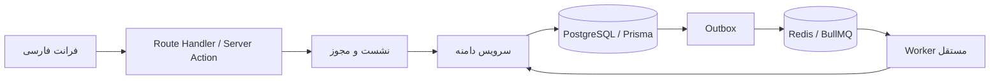

# معماری بک‌اند CRM هم‌مدار

## مسیر درخواست

Route Handlerها در `backend/api` و Server Actionها در `backend/features` قراردادهای ورودی Zod و سرویس‌های دامنه را به اشتراک می‌گذارند. فایل‌های `frontend/app/api` همان Handlerها را به مسیرهای عمومی Next.js متصل می‌کنند. فایل‌های React حالت رابط، فرم و نمایش نتیجه را مدیریت می‌کنند. `database/client.ts` اتصال Prisma، Pool و محدودهٔ تراکنش را فراهم می‌کند. انواع دادهٔ مشترک در `shared` قرار دارند. خطاهای ورودی و دامنه در پیام فارسی و شناسهٔ رهگیری خلاصه می‌شوند.

در حالت یکپارچه، آداپتر فرانت Handlerهای محلی را اجرا می‌کند. در Build مستقل، همان مسیرها با آداپتر HTTP به سرویس `backend/app/api` وصل می‌شوند. مرورگر همچنان مسیر نسبی `/api` و کوکی همان دامنه را استفاده می‌کند. [استقرار مستقل](./DEPLOYMENT.md)

## هویت و فضای کاری

OTP با عدد تصادفی رمزنگارانه تولید می‌شود. کد با HMAC، شمارندهٔ تلاش، زمان انقضا و قفل تراکنش بررسی می‌شود. نشست opaque با Digest، Cookie `HttpOnly` و انقضا نگهداری می‌شود. تغییر نقش و غیرفعال شدن عضویت در بررسی درخواست بعدی اثر دارد. در این نسخه اولین عضویت فعال حساب فضای پیش‌فرض است. مدیر سیستم در محدودهٔ فضای خودش کاربران و نقش‌ها را مدیریت می‌کند. کارشناس برای رکوردهای تخصیصی و شرکت‌های مرتبط مجوز محدود دارد. حسابرسی تغییرات حساس در همان تراکنش عملیات ثبت می‌شود. مدیر دارای مجوز تفویض‌شده فقط می‌تواند مجوزهای فعلی خودش را واگذار کند و نقش مدیر سیستم ویژهٔ مدیران سیستم است. اتوماسیون علاوه بر مجوز اختصاصی به دسترسی دامنهٔ تیم نیاز دارد، چون اجرا به رویدادهای سراسری فضای کاری دسترسی دارد.

## گردش‌کار و پیامک

تعریف معتبر گردش‌کار با شمارهٔ نسخهٔ تغییرناپذیر ذخیره می‌شود. هر اجرا به همان نسخه، سناریو، وضعیت و مرحله‌های ثبت‌شده وصل است. آزمایش دستی روی پیش‌نویس هم قابل ثبت است. فعال‌سازی، رویدادهای جدید از زمان فعال‌شدن را می‌پذیرد. Worker گام‌های داخلی، شرط، شاخه و تأخیر را از وضعیت ثبت‌شده بازیابی می‌کند. زمان‌بندی گردش‌کار پس از توقف، یک اجرای عقب‌افتاده را ثبت و دورهٔ بعد را محاسبه می‌کند.

نوشتن تغییر دامنه و ثبت Outbox در یک تراکنش است. Job فقط شناسهٔ رویداد و فضا را حمل می‌کند. قفل و کلید یکتای دیتابیس در برابر تحویل مجدد عمل می‌کنند. Redis یا Worker می‌تواند پس از توقف دوباره رویداد ثبت‌شده را بردارد. خطاهای موقت با backoff محدود دوباره بررسی می‌شوند. توپولوژی گراف و حداکثر عمق زنجیره از حلقهٔ عمل متقابل جلوگیری می‌کند.

پیامک شبیه‌سازی، متن و گیرندهٔ زمان ارسال و رخداد وضعیت را پایدار می‌کند. Retry به همان رکورد گیرنده متصل است. Webhook امضاشده برای تطبیق وضعیت یکپارچه‌سازی آینده آماده است. تولید کد توسعه، ارسال CRM و وضعیت‌های نمایشی از ارسال واقعی جدا هستند.

## عملکرد

جدول‌های اصلی، جست‌وجو، فیلتر، صفحه‌بندی و مرتب‌سازی را به سرور می‌سپارند. Kanban به‌ازای هر مرحله بخش محدودی از رکوردها را بارگیری می‌کند. فیلتر تاریخ گزارش در PostgreSQL با مرز روز فضای کاری اعمال می‌شود. مقادیر مالی دقیق به‌صورت رشته از API خارج می‌شوند. اعداد نمودار برای رسم به مقدار مقیاس‌شده تبدیل می‌شوند.

[پایگاه داده](./DATABASE.md) · [قرارداد API](./API_DOCUMENTATION.md) · [متغیرهای محیط](./ENVIRONMENT.md)
