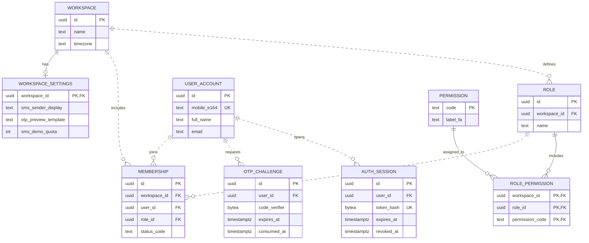
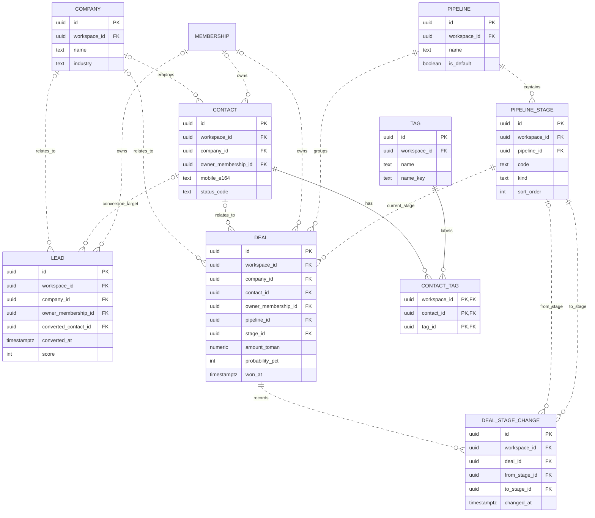
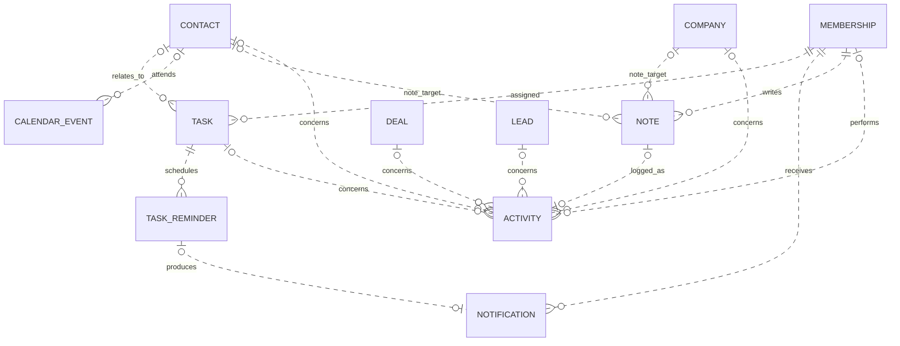
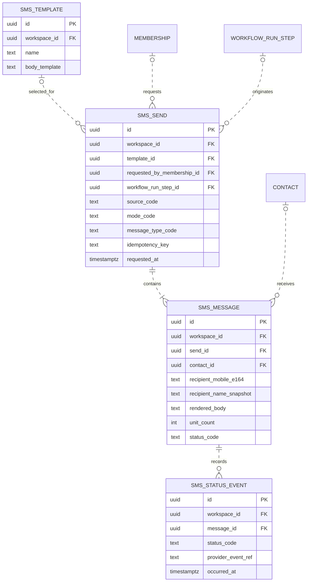
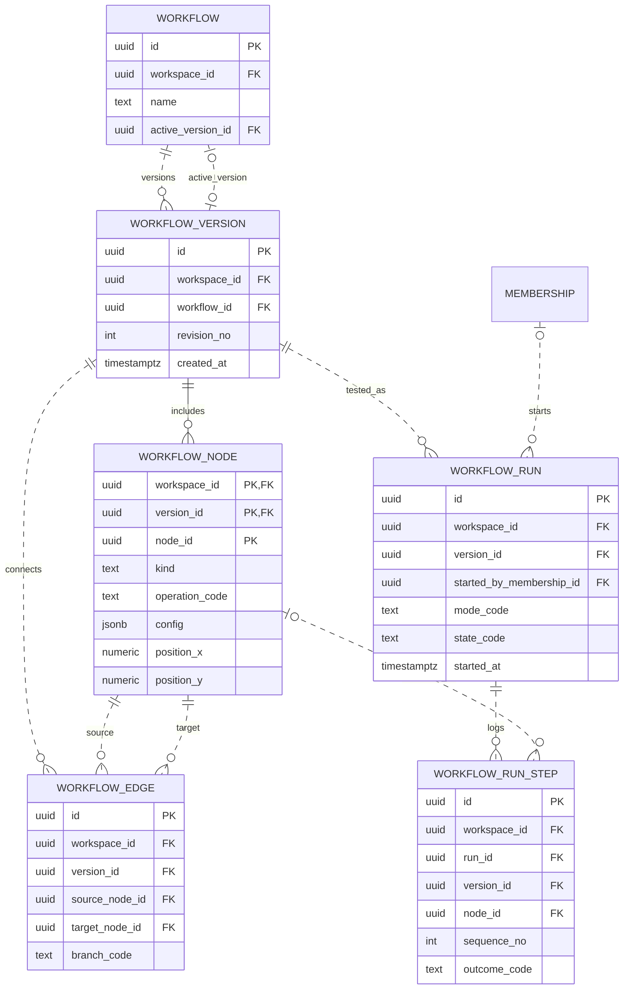

# طرح پایگاه دادهٔ CRM هم‌مدار

این سند مدل منطقی دادهٔ CRM را بر اساس صفحات و عملیات فرانت نشان می‌دهد. [طراحی فرانت](./DESIGN.md) · [Prisma Schema](./database/schema.prisma) · [راهنمای دیتابیس](./DATABASE.md)

## تکمیل‌های پیاده‌سازی

- مبلغ معامله با `NUMERIC(20,0)` ذخیره می‌شود. `row_version` در معامله و گردش‌کار برای تشخیص ویرایش هم‌زمان استفاده می‌شود.
- `auth_throttle` شمارندهٔ محدودیت درخواست و تأیید OTP را ذخیره می‌کند. `audit_log` با کلید خارجی مرکب به عضویت عامل و فضای کاری وصل است و شناسهٔ درخواست و هدف عملیات را نگه می‌دارد.
- `outbox_event` به `workspace` تعلق دارد. کلید یکتای آن در هر فضا و زمان آماده‌بودن و انتشار، تحویل مجدد و بازیابی پردازش Worker را ممکن می‌کنند.
- `workflow_version.is_draft` نسخهٔ آزمایش دستی را مشخص می‌کند. مسیر اجرای فعال از `active_version_id` خوانده می‌شود و هر اجرا به نسخهٔ ثابت خود ارجاع دارد.

## تصمیم‌های پایه

- **موتور پیشنهادی PostgreSQL است.** شناسهٔ رکوردها `UUID` است. اصطلاح‌های `PK`، `FK` و `UK` به‌ترتیب کلید اصلی، کلید خارجی و قید یکتایی‌اند. نمودارها کلیدها و فیلدهای شاخص را نشان می‌دهند. چیدمان روابط دامنه‌ای برای خوانایی به چند نمودار تقسیم شده است. [مستندات قیود PostgreSQL](https://www.postgresql.org/docs/current/ddl-constraints.html) · [راهنمای ERD در Mermaid](https://mermaid.js.org/syntax/entityRelationshipDiagram.html)
- **هر رکورد عملیاتی به یک فضای کاری تعلق دارد.** نسخهٔ نخست می‌تواند با یک فضای کاری آغاز شود. `workspace_id` در جداول دامنه و جداول واسط اجباری است. برای جدول‌های دارای `id` سراسری، جفت `(workspace_id, id)` نیز یکتا می‌شود تا کلیدهای خارجی مرکب از اتصال داده‌های دو فضای کاری جلوگیری کنند. کاتالوگ مجوزها، حساب ورود، چالش OTP و نشست سراسری‌اند. `membership.sessions_valid_after` اعتبار نشست‌های قدیمی را برای عضویت تغییر وضعیت‌یافته محدود می‌کند.
- **شناسه، کد و برچسب نقش‌های جدا دارند.** مسئول یک رکورد با `membership_id` مشخص می‌شود. مقادیر وضعیت و عملیات با کدهای ثابت مانند `qualified` و `send_sms` ذخیره می‌شوند. فرانت برچسب فارسی، رنگ و ارقام را از روی کد نمایش می‌دهد.
- **زمان و عدد در قالب استاندارد مبادله می‌شوند.** زمان وقوع با `timestamptz` و تاریخ تقویمی با `date` ذخیره می‌شود. منطقهٔ زمانی پیش‌فرض فضای کاری `Asia/Tehran` است. نمایش و ورودی شمسی در لایهٔ رابط انجام می‌شود. شمارهٔ موبایل به قالب E.164 مانند `+989123456789` تبدیل می‌شود. مبلغ معامله مبلغ صحیح و نامنفی به تومان است و برای حفظ دقت، در قرارداد JSON به‌صورت رشتهٔ عددی مبادله می‌شود.
- **بایگانی، سوابق مرتبط را حفظ می‌کند.** رکوردهای عملیاتی مانند مشتری، شرکت، سرنخ و فرصت با `deleted_at` از فهرست جاری کنار می‌روند. تاریخچه، گزارش و ارجاعات قبلی به رکورد بایگانی‌شده دسترسی دارند. عضویت غیرفعال از فهرست انتساب‌های تازه خارج می‌شود و ارجاعات قبلی را حفظ می‌کند. تاریخچهٔ یک رکورد تابع مجوز و محدودهٔ دسترسی فضای کاری آن است.

## ۱. فضای کاری، هویت و دسترسی

| موجودیت | نقش و قواعد |
| --- | --- |
| `workspace` و `workspace_settings` | نام و منطقهٔ زمانی فضای کاری، شمارهٔ نمایشی فرستنده، قالب پیش‌نمایش OTP و سقف اعتبار نمایشی پیامک. هنگام ایجاد فضای کاری، یک رکورد تنظیمات با مقدارهای اولیه ساخته می‌شود. |
| `user_account` و `membership` | پروفایل و شمارهٔ ورود در حساب سراسری نگهداری می‌شوند. هر حساب در هر فضا حداکثر یک عضویت دارد و هر عضویت در نسخهٔ نخست یک نقش دارد. `notifications_enabled` و `task_alerts_enabled` در عضویت ذخیره می‌شوند تا تنظیمات کاربر در هر فضا مستقل باشد. |
| `role`، `permission` و `role_permission` | نام نقش در همان فضا یکتاست. هر نقش چند مجوز دارد. کدهای پیشنهادی مانند `contacts.read`، `contacts.write`، `reports.read`، `sms.simulate` و `members.manage` به‌جای وابستگی به عنوان نمایشی نقش بررسی می‌شوند. |
| `otp_challenge` | چالش مربوط به حساب، دارای `issued_at`، `resend_after_at`، `expires_at`، `failed_attempts`، `invalidated_at` و `consumed_at` است. تنظیمات نمایشی فضای کاری صرفاً متن پیش‌نمایش را تغییر می‌دهند. |
| `auth_session` | نشست به حساب متعلق است. بررسی دسترسی هر درخواست به فضای کاری بر اساس عضویت فعال و مجوز همان فضا انجام می‌شود. `created_at`، `expires_at` و `revoked_at` برای چرخهٔ عمر نشست نگهداری می‌شوند. |

برای OTP واقعی، مقدار تصادفی شش‌رقمی با اعتبار و فاصلهٔ ارسال مجدد پیشنهادی ۱۲۰ ثانیه توسط سرور تولید می‌شود. اعتبارسنجی با مقدار مشتق‌شدهٔ کلیددار انجام می‌شود و رمز و توکن خام در دیتابیس و لاگ ذخیره نمی‌شوند. مصرف چالش و ایجاد نشست یک تراکنش‌اند. ارسال و تأیید محدودیت نرخ دارند و ارسال مجدد شمارندهٔ خطاهای حساب را بازنشانی نمی‌کند. پاسخ عمومی درخواست شماره از وجود حساب خبر نمی‌دهد. اسرار ارائه‌دهنده در مدیریت اسرار بک‌اند قرار می‌گیرند. [راهنمای احراز هویت NIST](https://pages.nist.gov/800-63-4/sp800-63b.html#out-of-band)

## ۲. مشتری، شرکت، سرنخ و فرصت فروش

| موجودیت | داده‌های تکمیلی و قواعد |
| --- | --- |
| `company` | نام، حوزهٔ فعالیت، تلفن، ایمیل، وب‌سایت و توضیحات. پروفایل شرکت، افراد و فرصت‌های مرتبط را از کلیدهای خارجی همان فضا می‌خواند. |
| `contact` | نام کامل، موبایل الزامی، ایمیل، سمت، شرکت اختیاری، مسئول اختیاری، وضعیت، منبع و توضیحات. شمارهٔ نرمال‌شدهٔ مشتری فعال در هر فضا یکتاست. منظور از فعال در این قید، رکورد بایگانی‌نشده با هر وضعیت تجاری است. |
| `tag` و `contact_tag` | رابطهٔ چندبه‌چند. `name_key` حاصل نرمال‌سازی عنوان فارسی و در هر فضا یکتاست. جدول واسط جلوی انتساب تکراری یک برچسب را می‌گیرد. |
| `lead` | نام، موبایل، ایمیل، شرکت و مسئول اختیاری، منبع، وضعیت، امتیاز صحیح ۰ تا ۱۰۰، `last_follow_up_on` و توضیحات. در وضعیت `converted` وجود مشتری مقصد و زمان تبدیل الزامی است. |
| `pipeline` و `pipeline_stage` | یک قیف پیش‌فرض به هر فضای کاری تخصیص می‌یابد. کد و ترتیب مرحله در همان قیف یکتاست. ترتیب شروع «شناسایی، ارزیابی، پیشنهاد، مذاکره، موفق، ناموفق» است. نوع مرحله `open`، `won` یا `lost` و احتمال پیشنهادی مرحله مقداردهی اولیه می‌شود. |
| `deal` | عنوان، روابط اختیاری با مشتری و شرکت و کارشناس، قیف و مرحلهٔ الزامی، مبلغ، احتمال ۰ تا ۱۰۰، `expected_close_on`، توضیحات و `row_version` برای کنترل ویرایش هم‌زمان. شناسهٔ مرحله با کلید خارجی مرکب به همان قیف محدود می‌شود. |
| `deal_stage_change` | مرحلهٔ مبدأ و مقصد، زمان تغییر و `changed_by_membership_id`. در تغییر اولیه مرحلهٔ مبدأ می‌تواند خالی باشد. مراحل ارجاع‌شده برای حفظ سابقه بایگانی می‌شوند. |

- **تبدیل سرنخ در یک تراکنش انجام می‌شود.** سرنخ قفل و وضعیت آن بررسی می‌شود. سپس مشتری با وضعیت بالقوه ایجاد می‌شود، `converted_contact_id` و `converted_at` ثبت می‌شوند و یک فعالیت مرتبط اضافه می‌شود. تکرار درخواست موفق، همان شناسهٔ مشتری را برمی‌گرداند. اگر از قبل مشتری دیگری با آن شماره وجود دارد، عملیات با تعارض دامنه‌ای پایان می‌یابد.
- **حرکت Kanban یک تغییر اتمی است.** نسخهٔ رکورد و مقصد بررسی می‌شوند و مرحله، احتمال، زمان موفقیت در صورت نیاز و رویداد تغییر در همان تراکنش ثبت می‌شوند. احتمال مراحل موفق و ناموفق به‌ترتیب ۱۰۰ و ۰ است. بازگشایی معامله، `won_at` جاری را خالی می‌کند و انتقال قبلی در تاریخچه باقی می‌ماند.

## ۳. وظیفه، تقویم، یادداشت و فعالیت

| موجودیت | داده‌ها و قواعد |
| --- | --- |
| `task` | `id`، فضای کاری، عنوان، مشتری اختیاری، `assignee_membership_id` الزامی، اولویت، وضعیت، `due_date`، `due_time` اختیاری، `completed_at` و توضیحات. ساعت پیش‌فرض روز کاری برای اعلان ۱۷:۰۰ در منطقهٔ زمانی فضای کاری است. |
| `task_reminder` | `id`، فضای کاری، وظیفه، `offset_minutes`، `scheduled_at` و وضعیت. رابط نخست یک یادآوری برای هر وظیفه ثبت می‌کند. تغییر سررسید یا تکمیل وظیفه، یادآوری منتظر را زمان‌بندی مجدد یا لغو می‌کند. |
| `calendar_event` | `id`، فضای کاری، عنوان، نوع جلسه، تماس یا وظیفهٔ دستی، `event_date`، `start_time` اختیاری، مشتری اختیاری و توضیحات. نمای ماهانه و هفتگی با خواندن رویدادها و نمایش سررسید `task` در کنار آن‌ها ساخته می‌شود. مسئولیت و تغییر وضعیت وظیفه در همان رکورد `task` ثبت می‌شود. |
| `note` | `id`، فضای کاری، متن، زمان ایجاد، نویسنده و دقیقاً یکی از `contact_id` یا `company_id`. این شرط در سطح رکورد بررسی می‌شود. ثبت یادداشت و فعالیت متناظر در یک تراکنش انجام می‌شود. |
| `activity` | `id`، فضای کاری، عنوان، شرح، `kind_code`، `occurred_at`، `actor_membership_id` اختیاری و پیوندهای اختیاری به مشتری، شرکت، سرنخ، فرصت، وظیفه یا یادداشت. امکان ثبت مشتری و شرکت هم‌زمان وجود دارد. پیوند یکتای یادداشت مانع ثبت دوبارهٔ همان رویداد می‌شود. |
| `notification` | `id`، فضای کاری، گیرنده، نوع، عنوان، متن، `created_at` و `read_at`. `task_reminder_id` در صورت وجود یکتاست تا تکرار پردازش یک یادآوری اعلان دوم نسازد. |

## ۴. پیامک، قالب و وضعیت تحویل

- `sms_template` نام و متن قابل‌ویرایش قالب را نگه می‌دارد. `sms_send` زمان درخواست، منبع و نوع پیام را برای مجموعهٔ گیرندگان ثبت می‌کند. یک درخواست ارسال به‌ازای هر شمارهٔ نرمال‌شده فقط یک `sms_message` دارد. انتخاب مشتری و ورود دستی همان شماره به یک گیرنده ادغام می‌شوند. شمارهٔ دستی بدون مشتری نیز پذیرفته می‌شود. ذخیرهٔ درخواست و پیام‌های گیرندگان یک تراکنش است.
- متن نهایی، نام و شمارهٔ گیرنده و تعداد واحد در زمان ارسال ذخیره می‌شوند. ویرایش قالب یا رکورد مشتری، تاریخچهٔ پیام دریافتی را تغییر نمی‌دهد. متغیرهای اولیه `{{customer_name}}` و `{{company_name}}` هستند. تاریخچه بر اساس زمان درخواست، نوع، منبع دستی یا اتوماسیون و وضعیت هر گیرنده خوانده می‌شود.
- `mode_code=simulation` ارسال‌های نمایشی را مشخص می‌کند. اعتبار نمایشی از سقف تنظیمات منهای مجموع واحدهای پیام‌های آزمایشی محاسبه می‌شود. نتیجهٔ دستی گردش‌کار در فاز شبیه‌سازی فقط در لاگ اجرا ثبت می‌شود. پیوند اختیاری به `workflow_run_step` برای اتصال ارسال‌های مرحلهٔ بعد به اجرای مبدأ در نظر گرفته شده است.
- برای اتصال آینده به ارائه‌دهنده، `sms_message` مرجع بیرونی پیام و زمان ارسال یا تحویل را نگه می‌دارد. `sms_status_event` رویدادهای تحویل را به‌صورت افزایشی ثبت می‌کند. شناسهٔ رویداد بیرونی در محدودهٔ حساب ارائه‌دهنده یکتاست و رویداد تکراری یا دیررس وضعیت نهایی را به «در انتظار» برنمی‌گرداند. وضعیت‌های `queued` و `submitted` در رابط به «در انتظار»، `delivered` به «موفق» و `failed` به «ناموفق» نگاشت می‌شوند.

## ۵. نسخه‌های اتوماسیون و لاگ اجرا

- `workflow` نام، شرح، زمان ایجاد و بایگانی دارد. هر ذخیره یک `workflow_version` مجزا با شمارهٔ ترتیبی یکتا در همان گردش‌کار می‌سازد. تهی بودن `active_version_id` به معنی غیرفعال بودن است. ذخیرهٔ یک نسخهٔ معتبر با وضعیت فعال، همان نسخه را فعال می‌کند. کلید خارجی مرکب به `(workspace_id, workflow_id, id)` تضمین می‌کند نسخهٔ فعال به همان گردش‌کار و فضای کاری تعلق دارد. کپی، گردش‌کاری تازه و غیرفعال با نسخهٔ اولیه از تعریف انتخاب‌شده ایجاد می‌کند.
- فیلد `config` در `workflow_node` بر اساس `kind` و `operation_code` اعتبارسنجی می‌شود. تنظیمات می‌تواند نوع رویداد آغازگر، مقایسهٔ وضعیت یا مبلغ، ترکیب شرط‌های «و» و «یا»، پیام یا زمان تأخیر را نگه دارد. شناسه و موقعیت نود برای بازکردن بوم React Flow حفظ می‌شوند.
- هر `workflow_edge` دو نود از همان نسخه را به هم وصل می‌کند. برای شاخهٔ هر شرط، در هر نسخه حداکثر یک خروجی `yes` و یک خروجی `no` وجود دارد. تکرار یال و اتصال یک نود به خودش در سطح داده رد می‌شوند. اعتبارسنجی فعال‌سازی و اجرا در سرویس بررسی می‌کند که دقیقاً یک آغازگر، دست‌کم یک اقدام و مسیرهای متصلِ بدون چرخه وجود داشته باشد.
- اجرای دستی روی نسخهٔ مشخص ثبت می‌شود. آزمایش بومِ ذخیره‌نشده یک نسخهٔ پیش‌نویس غیرفعال برای ارجاع لاگ می‌سازد. `workflow_run` سناریوی پالایش‌شده، زمان پایان و نتیجه را نگه می‌دارد. `workflow_run_step` ترتیب ثابت، پیام و نتیجهٔ هر نود را ذخیره می‌کند. خطای کلی اعتبارسنجی می‌تواند `node_id` خالی داشته باشد. کلیدهای مرکب تضمین می‌کنند نسخهٔ نود و نسخهٔ اجرا یکی‌اند. تعداد اجرا و آخرین اجرا از لاگ محاسبه می‌شوند.
- در فاز شبیه‌سازی، آغازگرهای زمان‌بندی‌شده، تأخیر، ایمیل و وب‌هوک به‌صورت نتیجهٔ آزمایشی در لاگ ثبت می‌شوند. اجرای رویدادمحور واقعی و یکپارچه‌سازی با سرویس بیرونی به فاز بعد تعلق دارند.

## کدهای دامنه برای اتصال به فرانت

| فیلد | کد و برچسب فارسی پیشنهادی |
| --- | --- |
| وضعیت مشتری | `active` فعال، `negotiating` در مذاکره، `potential` بالقوه، `inactive` غیرفعال |
| منبع جذب مشتری و سرنخ | `website` وب‌سایت، `referral` معرفی، `social` شبکه‌های اجتماعی، `direct` تماس مستقیم، `event` نمایشگاه |
| وضعیت سرنخ | `new` جدید، `following_up` در حال پیگیری، `qualified` واجد شرایط، `rejected` رد شده، `converted` تبدیل‌شده |
| مراحل اولیهٔ قیف | `discovery` شناسایی، `evaluation` ارزیابی، `proposal` پیشنهاد، `negotiation` مذاکره، `won` موفق، `lost` ناموفق |
| وضعیت و اولویت وظیفه | `open` باز، `in_progress` در حال انجام، `done` انجام‌شده. اولویت‌های `low` کم، `medium` متوسط، `high` زیاد |
| نوع رویداد تقویم | `meeting` جلسه، `call` تماس، `task` وظیفهٔ دستی |
| منبع و نوع پیامک | `manual` دستی، `automation` اتوماسیون. نوع‌های اولیه `notification` اطلاع‌رسانی، `follow_up` پیگیری، `welcome` خوشامدگویی |
| نتیجهٔ نود گردش‌کار | `succeeded` موفق، `condition_false` شرط رد شد، `skipped` اجرا نشد، `failed` خطا. رابط نخست می‌تواند دو نتیجهٔ میانی را با برچسب «رد شد» و توضیح علت نشان دهد. |
## اتصال به صفحات و گزارش‌ها

| مقصد فرانت | مبنای خواندن داده |
| --- | --- |
| `/contacts` و `/companies` | مشتری یا شرکت، وضعیت و منبع، افراد مرتبط، برچسب‌ها، یادداشت‌ها و فعالیت‌های مرتب‌شده بر اساس زمان. |
| `/leads` | وضعیت، امتیاز، منبع، مسئول، زمان آخرین پیگیری و نتیجهٔ تبدیل. |
| `/deals` | همان رکوردهای فرصت در جدول و Kanban. گروه‌بندی بر اساس مرحله و مرتب‌سازی مرحله بر اساس `sort_order`. ارزش وزنی برابر جمع `amount_toman × probability_pct / 100` برای مراحل باز است. |
| `/tasks`، `/calendar` و `/activities` | وظایف براساس سررسید و مسئول، رویدادهای بازهٔ تقویم و تاریخچهٔ تعاملات بر اساس `occurred_at`. |
| `/sms` و `/automations` | وضعیت پیام به‌ازای گیرنده، شمارش بر اساس نوع و نتیجه، تعریف نسخهٔ گردش‌کار و تاریخچهٔ اجرا. |
| `/settings` | پروفایل حساب، تنظیمات فضای کاری، تنظیمات اعلان عضویت و مدیریت نقش و مجوز. تم می‌تواند مانند فرانت فعلی ترجیح محلی مرورگر بماند. |
| `/dashboard` و `/reports` | مشتریان جدید به‌ازای `created_at`، روند فروش به‌ازای روز موفقیت معامله، قیف فعلی، وظایف روز، تبدیل سرنخ و آمار فعالیت، پیامک و اجرا. |

**تعریف گزارش‌ها.** فروش CRM برابر ارزش فرصت‌هایی است که اکنون موفق‌اند و `won_at` در بازهٔ گزارش قرار دارد. این شاخص نمایندهٔ ارزش معامله است. عملکرد کارشناس از همین عدد به تفکیک مسئول فرصت به دست می‌آید. نرخ تبدیل برابر تعداد سرنخ‌های تبدیل‌شده از میان سرنخ‌هایی است که در بازهٔ گزارش ایجاد شده‌اند، تقسیم بر تعداد کل همان گروه. قیف داشبورد وضعیت جاری را نشان می‌دهد. در گزارش بازه‌ای، گروه فرصت‌ها بر اساس تاریخ ایجاد انتخاب و سپس با مرحلهٔ فعلی گروه‌بندی می‌شوند. برای مقایسهٔ تاریخی «قیف در یک تاریخ گذشته»، منبع بازسازی `deal_stage_change` است.

رکوردهای `sales` در مخزن فعلی دادهٔ نمونه برای شکل‌دهی نمودارند. فروش عملیاتی از معامله استخراج می‌شود. اگر واردکردن فروش تاریخی واقعی لازم شد، ورودی وارداتی با شناسهٔ یکتای منبع و قاعدهٔ رفع هم‌پوشانی با معامله‌ها به گزارش اضافه می‌شود. تاریخ شمسی بازه در مرز API به تاریخ استاندارد تبدیل می‌شود. برای ستون‌های زمان‌دار، گزارش از ابتدای روز شروع تا پیش از ابتدای روز بعد از پایان در منطقهٔ زمانی فضای کاری محاسبه می‌شود.

## یکپارچگی، ایندکس و دسترسی

| موضوع | طرح پیشنهادی |
| --- | --- |
| یکتایی | عضویت `(workspace_id, user_id)`، عنوان نقش و نام نرمال برچسب در هر فضا، موبایل مشتری بایگانی‌نشده در هر فضا، شمارهٔ نسخه در هر گردش‌کار، `(send_id, recipient_mobile_e164)` و کلید تکرارناپذیری درخواست ارسال در هر فضا. برای موبایل مشتری از یکتایی جزئی بر اساس `deleted_at` استفاده می‌شود. |
| فهرست‌ها | برای پرس‌وجوهای پرتکرار، ایندکس از `workspace_id` شروع می‌شود. نام و موبایل نرمال برای جست‌وجو، `(workspace_id, status_code, created_at, id)` برای مشتری و سرنخ، `(workspace_id, pipeline_id, stage_id)` برای Kanban، `(workspace_id, assignee_membership_id, status_code, due_date)` برای وظایف و `(workspace_id, event_date)` برای تقویم. |
| تاریخچه و کارهای موعددار | ایندکس روی `(workspace_id, contact_id, occurred_at)` و معادل آن برای شرکت، `(workspace_id, requested_at)` برای ارسال‌ها، `(workspace_id, version_id, started_at)` برای اجراها و ایندکس یادآوری‌های منتظر بر اساس `scheduled_at`. شناسهٔ رکورد در مرتب‌سازی نقش رفع تساوی دارد. |
| مجوز و جداسازی | نقش سرویس HTTP با حداقل دسترسی، کنترل عضویت و مجوز در درخواست، و سیاست Row-Level Security به‌عنوان لایهٔ تکمیلی. زمینهٔ فضای کاری از نشست معتبر در محدودهٔ تراکنش تعیین می‌شود. حساب اجرای API مالک جدول یا دارای `BYPASSRLS` نیست. |
| نگهداشت | سوابق عملیاتی با ارجاعات حفظ می‌شوند. مدت نگهداشت متن پیام، اطلاعات گیرنده، سناریوی اجرا و دادهٔ امنیتی پیش از تولید تصویب می‌شود. چالش‌های منقضی طبق سیاست نگهداشت پاک می‌شوند. |

کلید خارجی مرکب برای جلوگیری از ارجاع میان فضاها، قید جزئی برای یکتایی موبایل جاری و سیاست سطح ردیف برای جلوگیری از خواندن دادهٔ خارج از فضا به کار می‌روند. قواعد گراف و قواعد چندجدولی مثل سازگاری وضعیت معامله با نوع مرحله در تراکنش سرویس بررسی می‌شوند. [قیود PostgreSQL](https://www.postgresql.org/docs/current/ddl-constraints.html) · [سیاست‌های سطح ردیف](https://www.postgresql.org/docs/current/ddl-rowsecurity.html)

## ترتیب پیشنهادی پیاده‌سازی آینده

1. **پایهٔ دسترسی و قرارداد داده.** توافق بر PostgreSQL، منطقهٔ زمانی، شناسه‌ها، سیاست بایگانی و کدهای دامنه. تعریف فضای کاری، حساب، عضویت، نقش و قرارداد نشست. دو فضای کاری نمونه برای آزمون مرز دسترسی.
2. **هستهٔ CRM.** شرکت، مشتری، برچسب، سرنخ، تبدیل اتمی، قیف و فرصت. سمت API، مانع تبدیل تکراری، تداخل شماره و انتقال مرحله با نسخهٔ قدیمی آزموده شود.
3. **همکاری و گزارش.** وظیفه، تقویم، یادداشت، فعالیت و اعلان. بررسی مرز روز شمسی، استثنای بازگشایی معامله و تطابق گزارش‌ها با تعریف شاخص‌ها.
4. **پیامک و اتوماسیون آزمایشی.** ذخیرهٔ قالب و خروجی گیرنده‌ها، اجرای دستی نسخه‌دار، گزارش خطا و آزمون شاخه‌های شرط. کنترل یکتایی ارسال و حفظ تاریخچه پس از ویرایش قالب یا گردش‌کار.
5. **اتصال تدریجی فرانت.** آداپتر REST جایگزین مخزن localStorage شود. رشتهٔ خالیِ رابطه به `null`، نام مسئول به شناسهٔ عضویت، تاریخ استاندارد به نمایش شمسی، مبلغ به رشتهٔ عددی و وضعیت فارسی به کد پایدار نگاشت شود. برای جدول‌ها قرارداد صفحه‌بندی، مرتب‌سازی، جست‌وجو و فیلتر سمت سرور تعریف شود. داده‌های نمونه در محیط آزمایش با شناسه‌های جدید بارگذاری شوند و ورود اطلاعات عملیاتی مرورگر، در صورت نیاز، با فرایند جداگانهٔ اعتبارسنجی و تطبیق انجام شود.
6. **اتصال سرویس‌های واقعی با تصمیم مستقل.** ارائه‌دهندهٔ OTP و پیامک، نحوهٔ همگام‌سازی وضعیت ارسال و سیاست اعتبار واقعی، نگهداشت اطلاعات و در صورت نیاز اجرای پس‌زمینهٔ گردش‌کار مشخص شوند.
